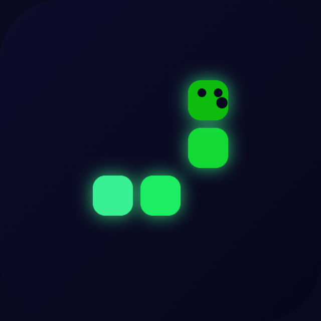

# WORMOJI



A neon bitmoji-headed snake, built as a Snapchat Web Lens.

## Play

Drag to steer — the snake follows your finger's direction continuously. Eat the glowing orbs
to grow and score; the game speeds up as you go. Hit a wall or your own tail and it's over.

## Local run

```bash
npm install
npm start        # builds to dist/ and serves it, prints the local URL
```

## Snapchat Lens packaging

```bash
npm run build
npm run lens -- 1   # -> wormoji-lens-v1.zip, checked against Snap's Web Lens requirements
```

## Testing

```bash
npm test
```

## Architecture

- `src/game/` — pure game logic: `state.ts` (grid constants, `GameState`, the tick-speed
  difficulty curve), `physics.ts` (bounds + self-collision, tail-vacates-this-tick aware),
  `loop.ts` (`step(state, input, dt, hooks)`, tick-based movement), `input.ts` (a re-centering
  drag "joystick" that reads continuous steering from one unbroken finger drag).
- `src/render/draw.ts` — all Canvas 2D drawing: the neon grid, glowing gradient snake body,
  a directional bitmoji-style face on the head, a pulsing food orb, and the Bitmoji avatar
  badge on the title screen.
- `src/audio/sound.ts` — procedural Web Audio sound effects and an ambient pad, no audio files.
- `src/snap/profile.ts` — Snapchat leaderboard + Bitmoji + storage, with a `localStorage`
  fallback outside Snapchat.
- `src/main.ts` — the only file touching the DOM: canvas fit, pointer events, the game loop.

No image or audio assets beyond `assets/icon.png` (the Lens Icon upload) — everything else is
drawn or synthesized in code.
